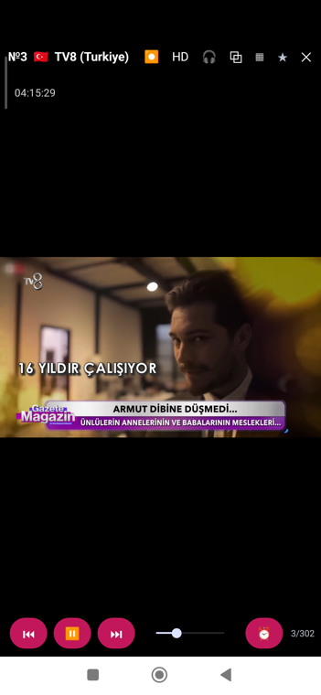

# Canlı TV (Android)

Reklamsız, hesapsız, **ücretsiz** canlı TV uygulaması. 302 kanal tek listede; kanallar uygulamanın
içine gömülü olduğu için hiçbir siteye yönlendirme yapmaz, tarayıcı açılmaz.

Tek dosya APK: [`CanliTV.apk`](CanliTV.apk) (Android 8.0+, imzalı)

## Özellikler

- **Numaralı kanallar** – kumanda gibi: üstteki *No* kutusuna numarayı yaz → **Git** → onay → açılır.
- **Kanal sırası** – büyük Türk kanalları en üstte (TRT 1, TRT 2, TV8, ATV, Star TV, Kanal D, Haber Global, NTV, A Haber, Halk TV, Kanal 7, TRT Spor…) sonra diğer TR kanalları, en sonda yabancılar.
- **Ülke bayrağı** ve **🇹🇷 Türkçe / 🌐 Yabancı / 🕘 Son izlenenler / ★ Favoriler** filtreleri.
- **Arama** – kanal adı, grup veya numara.
- **Tek ekran oynatıcı** – saydam saat, ses çubuğu, önceki/sonraki, favori, HD, kayıt, PiP.
- **Uyku zamanlayıcısı** – 15/30/45/60/90/120 dk veya saat gir (23:30 gibi); süre dolunca uygulama kapanır, kalan süre saatte canlı sayar.
- **3'lü / 4'lü izleme (2×2)** – her pencerenin sesi ayrı açılıp kapanır, pencereye dokununca o pencere solo olur.
  - Pencerelere uzun bas → **aranabilir** kanal seçici (numara veya ad yazarak).
  - Kontrol paneli: **1□ 2□ 3□ ⊞4**, **no kutusu + ⏺ kayıt** (istediğin ekranı kaydeder), **★ set** (seti favori olarak kaydet).
  - Son kullanılan set otomatik hatırlanır; ana ekranda "▦ 3'lü" düğmesine uzun basınca kayıtlı setler açılır.
- **Kayıt** – ses dahil `.ts` olarak `Movies/TV-Kayitlari` klasörüne yazılır; uygulama içi **Kayıtlarım** ekranından izlenir.
- **Mobil veri uyarısı** – Wi-Fi yokken onay ister; *Sadece ses* seçeneğiyle görüntü indirmeden dinlenebilir.
- **Veri sayacı + günlük limit** – ana ekranda "📶 Bugün: 143 MB / 500 MB"; kanal satırında o kanalın harcadığı veri ve süre.
- **Sağlık taraması** – tüm kanalları test edip açılmayanları işaretler/gizler (⚙ menüsü).
- **Arka planda ses** – ekran kapalıyken dinleme (ön plan servisi + bildirim).

## Mimari

Gradle kullanılmaz; doğrudan SDK araçlarıyla derlenir:

```
aapt2 compile → aapt2 link → javac --release 11 → d8 → zipalign → apksigner
```

Saf Android framework (AndroidX/Media3 yok). Oynatma `VideoView` (tek ekran) ve
`SurfaceView + MediaPlayer` (çoklu ekran, pencere başına ses).

```
src/com/cengiz/canlitv/
  MainActivity.java      liste, numara, filtreler, veri çubuğu, ayarlar, sağlık taraması
  PlayerActivity.java    oynatıcı, saat, uyku zamanlayıcısı, kalite, kayıt, PiP
  MultiActivity.java     1-4 pencere, pencere sesi, kayıt paneli, setler
  RecordingsActivity.java kayıt kütüphanesi (MediaStore)
  HlsRecorder.java       HLS segmentlerini .ts olarak Movies/TV-Kayitlari'na yazar
  Quality.java           master m3u8 varyantlarını (HD/SD) çözer
  Channel.java / ChannelRepo.java / Prefs.java / Net.java / AudioService.java / LogoLoader.java
assets/channels.m3u      302 kanal (iptv-org, tek tek test edilmiş)
```

## Derleme

```bash
# Android SDK build-tools 36.0.0 ve JDK 11+ gerekir
bash build.sh          # → CanliTV.apk
adb install -r CanliTV.apk
```

Yollar `build.sh` başında (`SDK`, `BT`, `PLATFORM`) tanımlıdır.

## Kanal listesi

`assets/channels.m3u` içeriği [iptv-org](https://github.com/iptv-org/iptv) açık kaynaklı halka açık
yayın listesinden üretilir; her URL tek tek test edilir (HTTP 200 + `#EXTM3U`) ve sadece çalışanlar
eklenir. Sıralama `_build/sirala.py` ile yapılır.

## Notlar

- Yayınlar üçüncü tarafların halka açık akışlarıdır; kanallar zaman zaman yayını kaldırabilir
  (⚙ → *Tüm kanalları test et* ile güncel durumu görürsün).
- Canlı altyazıyı Türkçeye çevirme, EPG (program rehberi) ve Chromecast bu sürümde yok:
  ek kütüphane/veri kaynağı gerektiriyor.

## Ekran görüntüleri

| Ana ekran | Oynatıcı | Çoklu ekran |
|---|---|---|
|  |  |  |
