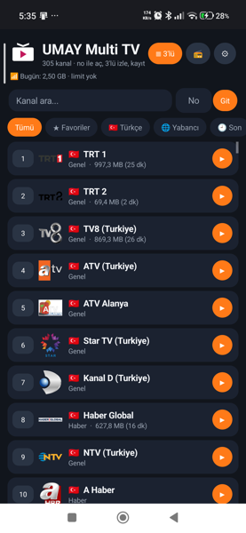
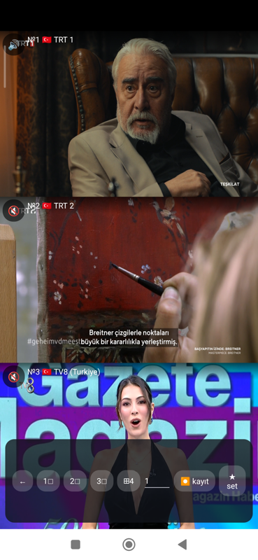

# UMAY Multi TV (Android)

Reklamsız, hesapsız, **ücretsiz** canlı TV + radyo uygulaması. 300+ kanal ve 49 radyo tek listede;
yayınlar uygulamanın içine gömülü olduğu için hiçbir siteye yönlendirme yapmaz, tarayıcı açılmaz.

Tek dosya APK: [`CanliTV.apk`](CanliTV.apk) (Android 8.0+, imzalı)

## Özellikler

- **Numaralı kanallar** – kumanda gibi: üstteki *No* kutusuna numarayı yaz → **Git** → onay → açılır.
- **📻 Radyo** – 49 internet radyosu (TRT, Kral, Power, Süper, Metro, Joy, Radyo 7, Karadeniz FM, TRT Trabzon…); üstteki radyo düğmesinden açılır, **ekran kilitliyken de çalar** (ön plan servisi + wake/Wi-Fi lock).
- **Liste yönetimi** – bir kanala/radyoya uzun bas → *Listeden gizle*; "🗑 Gizlenenler" sekmesinden geri ekle. Böylece 300 kanalı kendi zevkine göre 50'ye indirebilirsin.
- **Liste düzenleme** – *✏️ Düzenle*: çoklu seçim, satırdaki ▲▼ ile taşıma, seçilenleri en üste/en alta alma, numara değiştirme (dolu numarada karşılıklı yer değiştirir) ve silme. Her sekmede (Tümü, Favoriler, Türkçe, Yabancı, gruplar) ayrı ve kalıcı.
- **Sıralama** – *⇅ Sırala*: çok izlediklerim üstte, hiç izlemediklerim üstte, A→Z, numaraya göre, varsayılana dön.
- **Kalite / veri kontrolü** – 360p, 480p, 720p, 1080p, en düşük ve otomatik; her seçenekte saatlik tahmini GB yazar. Seçim oynatıcı, çoklu ekran ve "sadece ses" için geçerlidir.
- **Ayarlar sayfası** – açılır pencere yerine tam ekran; her satırda ikon, açıklama ve güncel değer.
- **Oynatıcı düğmeleri** – ikon + yazı ile büyütüldü; 🏠 Ana sayfa ve ✕ Kapat. Çoklu ekranda 🏠 ana sayfa, ⏹ TV'yi kapat.
- **Kanal sırası** – büyük Türk kanalları en üstte (TRT 1, TRT 2, TV8, ATV, Star TV, Kanal D, Haber Global, NTV, A Haber, Halk TV, Kanal 7, TRT Spor…) sonra diğer TR kanalları, en sonda yabancılar.
- **Ülke bayrağı** ve **🇹🇷 Türkçe / 🌐 Yabancı / 🕘 Son izlenenler / ★ Favoriler** filtreleri.
- **🌍 Ülke seçimi (50 ülke)** – üstteki bayrak düğmesi → *Ülke seç*. Seçilen ülkenin kanalları
  [iptv-org](https://github.com/iptv-org/iptv) ülke listesinden indirilir, `files/country_<cc>.m3u`
  olarak önbelleğe alınır ve liste o ülkeye göre yeniden kurulur. Türkiye gömülüdür (internet gerekmez);
  diğer ülkeler bir kez indirilir, sonra çevrimdışı açılır. Uzun bas → yeniden indir.
- **👤 Hesap (isteğe bağlı)** – Ayarlar → Hesap: e-posta + şifre ile üye ol, 6 haneli kod ile doğrula,
  Google ile gir. Şifre cihazda PBKDF2 ile özetlenir. Üye olmayan "misafir" olarak her şeyi kullanır.
- **📢 Reklamlar (AdMob)** – liste altında banner; her 4. kanal açılışında bir, en az 10 dakika
  arayla geçiş reklamı. Video oynarken ekranda reklam yok. Reklam yüklenmezse uygulama normal çalışır.
  Debug derlemede Google'ın **test reklamları** kullanılır (kendi reklamına tıklama riski yok).
- **📧 Üyelik sunucusu** – `site/worker.js` (Cloudflare Worker + D1): `/api/register`, `/api/verify`,
  `/api/resend`, `/api/login`, `/api/health`, `/api/google/*`. Hoş geldin maili + doğrulama kodu.
  Kurulum: [`docs/play/uyelik-kurulum.md`](docs/play/uyelik-kurulum.md).
- **Çoklu dil** – 🇹🇷 Türkçe, 🇬🇧 English, 🇷🇺 Русский, 🇸🇦 العربية (Ayarlar → Genel → Dil).
  Menü/sekme/başlık metinleri seçilen dilde; kanal adları yayıncıdan geldiği gibi kalır.
- **Arama** – kanal adı, grup veya numara.
- **Tek ekran oynatıcı** – saydam saat, ses çubuğu, önceki/sonraki, favori, HD, kayıt, PiP.
- **Uyku zamanlayıcısı** – 15/30/45/60/90/120 dk veya saat gir (23:30 gibi); süre dolunca uygulama kapanır, kalan süre saatte canlı sayar.
- **3'lü / 4'lü izleme (2×2)** – her pencerenin sesi ayrı açılıp kapanır, pencereye dokununca o pencere solo olur.
  - Pencerelere uzun bas → **aranabilir** kanal seçici (numara veya ad yazarak).
  - Kontrol paneli: **1□ 2□ 3□ ⊞4**, **no kutusu + ⏺ kayıt** (istediğin ekranı kaydeder), **★ set** (seti favori olarak kaydet).
  - Son kullanılan set otomatik hatırlanır; ana ekranda "▦ 3'lü" düğmesine uzun basınca kayıtlı setler açılır.
- **Kayıt** – ses dahil `.ts` olarak `Movies/TV-Kayitlari` klasörüne yazılır; uygulama içi **Kayıtlarım** ekranından izlenir.
- **Mobil veri uyarısı** – Wi-Fi yokken onay ister; *Sadece ses* seçeneğiyle görüntü indirmeden dinlenebilir.
- **Veri sayacı + günlük limit** – ana ekranda "📶 Bugün: 143 MB / 500 MB"; kanal satırında o kanalın harcadığı veri ve süre.
- **Sağlık taraması** – tüm kanalları test edip açılmayanları işaretler/gizler (⚙ menüsü).
- **Arka planda ses** – ekran kapalıyken dinleme (ön plan servisi + bildirim).

## Mimari

Gradle ile derlenir (AdMob SDK'sı AAR olduğu için gerekiyor):

```
app srcDirs → aapt2/manifest merge → javac → d8 → APK / AAB (AGP 8.13, Gradle 8.14)
```

Uygulama kodu saf Android framework (AndroidX/Media3 yok); AndroidX yalnızca reklam SDK'sının
kendi bağımlılığı olarak gelir. Oynatma `VideoView` (tek ekran) ve
`SurfaceView + MediaPlayer` (çoklu ekran, pencere başına ses).

```
src/com/cengiz/canlitv/
  MainActivity.java      liste, numara, filtreler, veri çubuğu, ayarlar, sağlık taraması
  PlayerActivity.java    oynatıcı, saat, uyku zamanlayıcısı, kalite, kayıt, PiP
  MultiActivity.java     1-4 pencere, pencere sesi, kayıt paneli, setler
  RecordingsActivity.java kayıt kütüphanesi (MediaStore)
  HlsRecorder.java       HLS segmentlerini .ts olarak Movies/TV-Kayitlari'na yazar
  Quality.java           master m3u8 varyantlarını (HD/SD) çözer
  Channel.java / ChannelRepo.java / Prefs.java / Net.java / AudioService.java / LogoLoader.java
  Countries.java         50 ülke (kod, TR/EN ad, bayrak)
  CountryActivity.java   ülke seçme ekranı (indir / seç / yeniden indir)
  CountryRepo.java       ülke m3u indirme, önbellek (files/country_<cc>.m3u), ayrıştırma
  Lang.java              tr/en/ru/ar sözlüğü (görünen metinler)
  Account.java           hesap durumu + PBKDF2 şifre özeti (düz şifre saklanmaz)
  AccountActivity.java   giriş / üye ol / kod doğrulama / Google / misafir
  Api.java               üyelik sunucusu istemcisi (HttpURLConnection, ek kütüphane yok)
  Ads.java               AdMob kimlikleri, test/gerçek birimler, reklam kuralları
  AdManager.java         banner + geçiş reklamı yönetimi (frekans sınırlı)
assets/channels.m3u      302 kanal (iptv-org, tek tek test edilmiş)
```

## Derleme

```bash
# Gereken: Android SDK (platform 36, build-tools 36), JDK 21 ve Gradle 8.14
# Araclar proje icinde: _build/tools/gradle-8.14.3, _build/tools/jdk-21*
bash build.sh          # → CanliTV.apk  (debug anahtari, uzerine guncellenebilir)
bash make-aab.sh       # → CanliTV.aab  (Play icin upload anahtari)
bash gradle-build.sh assembleDebug   # test reklamlariyla hizli deneme
adb install -r CanliTV.apk
```

`gradle-build.sh` JDK 21'i ve Gradle'i `_build/tools` icinden kullanir; `local.properties`
ve Gradle icin `package` satiri silinmis manifest kopyasi (`_build/gradle/`) otomatik uretilir.

## Sürüm arşivi

Her revizyon kendi klasöründe durur: `releases/v6.0/`, `releases/v7.0/`, `releases/v8.0/`, `releases/v9.0/`
(APK + AAB + `SURUM-NOTLARI.md` + ekran görüntüsü). Kökteki `CanliTV.apk` her zaman en son derlemedir.

## Kanal listesi

`assets/channels.m3u` içeriği [iptv-org](https://github.com/iptv-org/iptv) açık kaynaklı halka açık
yayın listesinden üretilir; her URL tek tek test edilir (HTTP 200 + `#EXTM3U`) ve sadece çalışanlar
eklenir. Sıralama `_build/sirala.py` ile yapılır.

## Notlar

- Yayınlar üçüncü tarafların halka açık akışlarıdır; kanallar zaman zaman yayını kaldırabilir
  (⚙ → *Tüm kanalları test et* ile güncel durumu görürsün).
- Canlı altyazıyı Türkçeye çevirme, EPG (program rehberi) ve Chromecast bu sürümde yok:
  ek kütüphane/veri kaynağı gerektiriyor.

## Ekran görüntüleri

| Ana ekran | Oynatıcı | Çoklu ekran |
|---|---|---|
|  |  |  |
